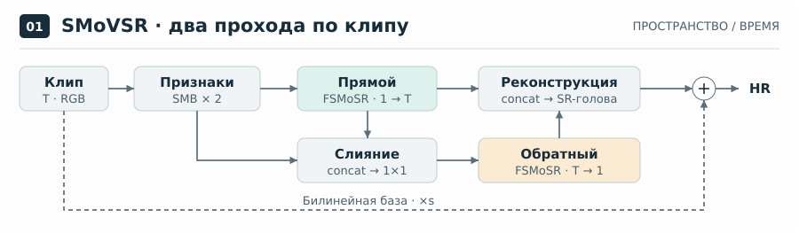

# SMoVSR

SMoVSR повышает пространственное разрешение каждого кадра видео, сохраняя длину клипа. Детали восстанавливаются по соседним кадрам в обоих направлениях, а базовое изображение получается билинейным увеличением входа. Поэтому для результата в начале клипа нужен и его конец: модель не каузальная.

## От клипа к кадрам высокого разрешения



Для RGB-входа формы `B × T × 3 × H × W` выход имеет форму `B × T × 3 × sH × sW`. По умолчанию `s = 2`, ширина признаков `dim = 32`. Два блока `SMB` извлекают признаки каждого кадра на исходной сетке. Прямой `FSMoSR` читает клип от первого кадра к последнему; обратный имеет **свои веса** и на каждом шаге получает не только признаки кадра, но и выход прямого прохода для этого же момента.

Оба выхода конкатенируются по каналам. Голова `1×1 → PReLU → 3×3 → PixelShuffle` превращает их в RGB-поправку (при `s = 1` перестановка пикселей не нужна). Поправка прибавляется к билинейной базе, а не заменяет её.

## Что переносится между кадрами


- **Выход и память различны.** Для входа шага `x` и выровненной памяти `a` три блока `SMB` вычисляют `f = blocks(x + a)`. Выход шага строится из `f + x`. В соседний кадр передаётся не этот выход, а смесь `a + z ⊙ (f − a)`, где `z = sigmoid(Conv1×1(cat(x, a)))`. На первом шаге каждого направления истории нет: `f = blocks(x)`, и `f` инициализирует память.
- **Выравнивание без явного оптического потока.** По умолчанию память фильтруется поканальной свёрткой `7×7`. При `align_kernel=None` каналы делятся на четыре ветви: без фильтра, `3×3`, `1×15` и `15×1`. Необязательный `h_clamp` ограничивает начальное состояние, выровненную память и кандидат `f` для обновления памяти; ветвь выхода использует `f` до ограничения.
- **Локальная обработка.** В `SMB` три свёртки `3×3`, между ними — `SiLU`. При неизменной ширине результат `u` управляет остаточной связью: `(u + x) ⊙ tanh(Conv1×1(u))`. При смене ширины блок возвращает `SiLU(u)` без этой связи.
- **Свёртки для инференса.** По умолчанию `rep=True`: внутри `ConvNXC` обучаются цепочка `1×1 → k×k → 1×1` и параллельная ветвь `1×1`. Вызов `.eval()` объединяет их веса и смещения в одну `Conv2d`. При `rep=False` вместо `ConvNXC` используются `DOConv2d`, которые также подготавливают ядро при переходе в `.eval()`.

Реализация: [`SMoVSR`, `FSMoSR` и `SMB`](smovsr_arch.py). Обе векторные схемы генерируются из корня репозитория одной командой, без PyTorch и графического редактора:

```sh
python3 scripts/draw_architecture.py
```