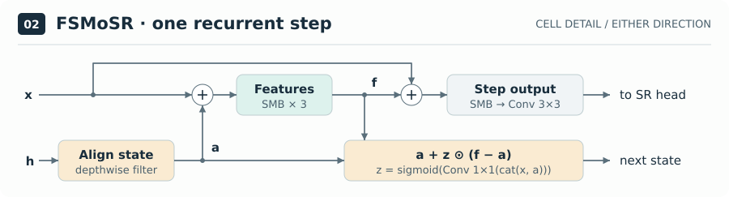

# SMoVSR

SMoVSR increases the resolution of every frame in an RGB video clip without changing its frame count. It predicts a correction to a bilinearly upscaled frame using information from both earlier and later frames. Even the first output frame can depend on the last input frame, so the model is not causal.

## From low-resolution clip to high-resolution frames


An RGB clip of shape `B × T × 3 × H × W` produces `B × T × 3 × sH × sW`. The default scale factor is `s = 2`, with `dim = 32` feature channels. Two `SMB` blocks extract features independently from each frame at the input resolution. The forward `FSMoSR` reads the clip from first frame to last. The backward `FSMoSR` has its own weights: at each frame, a `1×1` convolution combines the frame features with the matching forward output.

The reconstruction head concatenates the two directional outputs along the channel axis. A `1×1` convolution, `PReLU`, and a `3×3` convolution predict the subpixels; `PixelShuffle` rearranges them into a high-resolution RGB residual. At `s = 1`, no rearrangement is needed. The residual is added to the bilinear baseline.

## What passes between frames?



- **Frame output and recurrent state are distinct.** Given input `x` and aligned state `a`, three `SMB` blocks compute `f = blocks(x + a)`. The output branch takes `f + x`, while the next step receives `a + z ⊙ (f − a)`, where `z = sigmoid(Conv1×1(cat(x, a)))`. At the first step in either direction there is no previous state: `f = blocks(x)` initializes the state directly.
- **Alignment needs no explicit optical flow.** By default, a `7×7` depthwise convolution filters the previous state. With `align_kernel=None`, channels are split across an identity branch and three depthwise filters: `3×3`, `1×15`, and `15×1`. Optional `h_clamp` bounds the initial state, the aligned state, and the candidate `f` used for the state update. The output branch still uses the unclamped `f`.
- **Gated spatial blocks.** An `SMB` applies three `3×3` convolutions with `SiLU` between them. When the channel count stays constant, the last convolution's output `u` gates the residual: `(u + x) ⊙ tanh(Conv1×1(u))`. When the width changes, the block returns `SiLU(u)` without a skip connection.
- **Convolution fusion at inference.** With the default `rep=True`, each `ConvNXC` trains a `1×1 → k×k → 1×1` path alongside a `1×1` skip. Calling `.eval()` folds both paths into one `Conv2d`. With `rep=False`, `DOConv2d` replaces `ConvNXC` and also prepares its inference kernel on `.eval()`.

See [`SMoVSR`, `FSMoSR`, and `SMB`](smovsr_arch.py) for the implementation. To regenerate both SVG figures from the repository root, run the following command. Only the Python standard library is required.

```sh
python3 scripts/draw_architecture.py
```